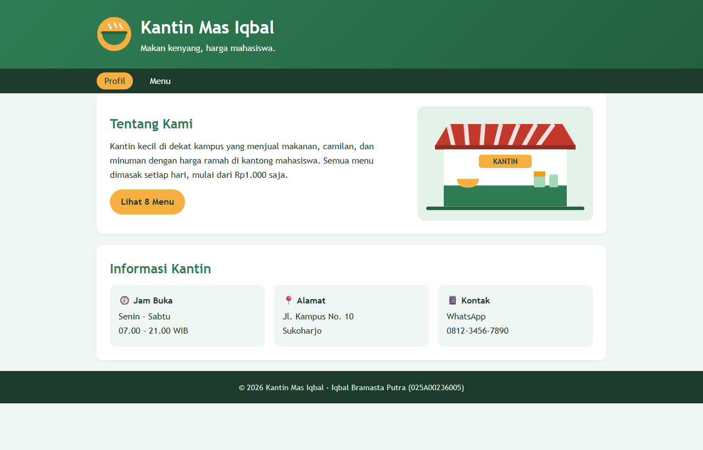
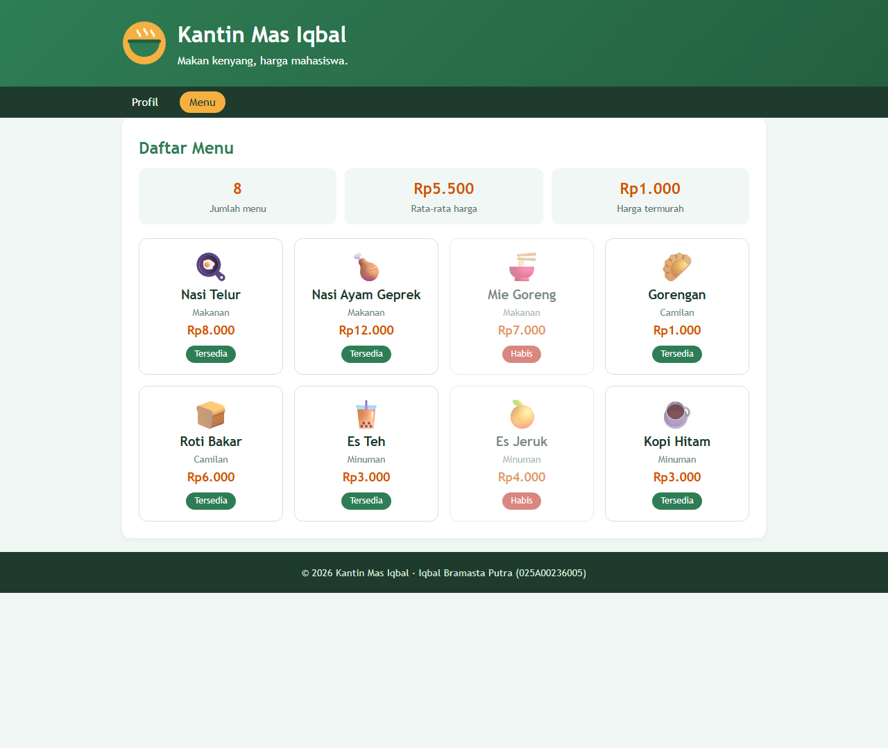

# UTS Pemrograman Web - Kantin Mas Iqbal

## Identitas
- Nama: Iqbal Bramasta Putra
- NIM: 025A00236005
- Mata kuliah: Pemrograman Web (253A23W15)

## Tema
Menu kantin/kafe. Halaman profil berisi info kantin (jam buka, alamat, kontak).
Halaman menu menampilkan 8 menu dengan atribut ikon, nama, kategori, harga, dan tersedia.
Menu yang tidak tersedia diberi label **"Habis"**. Di atas daftar menu ada ringkasan:
jumlah menu, rata-rata harga, dan harga termurah.

## Struktur File
- `data.php` - data nama situs dan daftar menu (array multidimensi)
- `functions.php` - fungsi `e()`, `formatRupiah()`, `hitungRataRataHarga()`
- `index.php` - halaman profil
- `katalog.php` - halaman daftar menu (foreach + if)
- `style.css` - tampilan
- `assets/` - gambar logo dan ilustrasi kantin (SVG)
- `screenshots/` - tangkapan layar

## Cara Menjalankan
1. Install XAMPP (atau Laragon).
2. Salin folder `uts-pemweb-025A00236005` ke `C:\xampp\htdocs\` (Laragon: `C:\laragon\www\`).
3. Jalankan **Apache** dari XAMPP Control Panel.
4. Buka browser: `http://localhost/uts-pemweb-025A00236005/`

## Tangkapan Layar
Halaman Profil:

Halaman Menu:

## Referensi
- php.net (`number_format`, `array_column`, `array_sum`, `count`, `min`)
- MDN Web Docs (elemen semantik HTML, CSS grid, media query)
- Contoh Toko Kue dari dosen (pola struktur file)

## Bantuan AI
Saya memakai bantuan AI (Claude) untuk membuat kerangka awal kode dan styling CSS.
Saya sudah mempelajari dan bisa menjelaskan semua kode di proyek ini.
